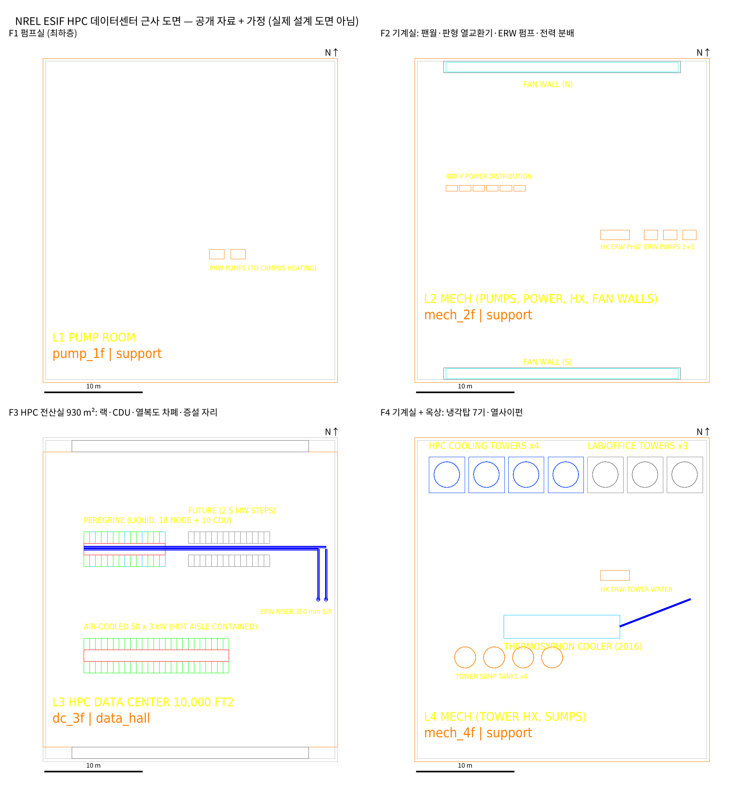
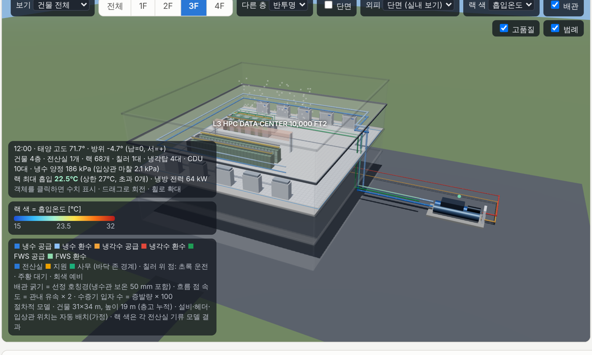

# NREL ESIF HPC 데이터센터 근사 도면

공개 자료로 확인한 사실과 명시한 가정으로 만든 **근사 도면**입니다. 실제 설계 도면이 아닙니다. 대상 시기는 실측 비교 기간(2016-09 ~ 2017-08)으로, Peregrine 운영 시기에 맞췄습니다.

| 파일 | 내용 |
|---|---|
| `gen_esif.py` | 치수 정의 → `esif_approx.dxf`, `esif_approx_facts.json` (사실·가정·개수) |
| `import_esif.py` | 위 DXF를 **프로젝트 CAD 가져오기(hvac.cad)로 변환** → `backend/data/scenario_esif_mz.json`, `esif_import_report.json` |
| `preview_esif.py` | 층별 평면 미리보기 → `preview_esif.png` |
| `esif_3d_all.png`, `esif_3d_3f.png` | 시뮬레이터 3D 화면 캡처 (변환한 시나리오) |

## 공개 자료로 확인한 사실

| 항목 | 내용 | 출처 |
|---|---|---|
| 전산실 | 약 930 m² (10,000 ft²), 기둥 없는 단일 공간, 천장 11 ft | NREL fy17osti 66690, fy12osti 55423 |
| 층 구성 | 맨 위 전산실 / 가운데 층 펌프·전력 분배 / 맨 아래 펌프실(중앙 냉난방 연결) | fy12osti 55423 |
| 기계실 | ERW → 건물 난방수 판형 열교환기는 전산실 아래 기계실, 사무동과 실험동 사이 중앙 | fy17osti 66690 |
| 4층 기계실 | 열 재활용 후 남은 ERW는 4층 기계실로 감 (열사이펀 → 냉각탑 순) | NREL 데이터센터 냉각 시스템 페이지 |
| 공기 경로 | 천장 플레넘 → 북·남측 환기 통로 → 팬월 공조기. 일반 CRAH 없음 | fy12osti 55423, fy17osti 66690 |
| 차폐·온도 | 열복도 완전 차폐, 팬월 급기 20.6~23.3 ℃, 실내 25.6 ± 1.1 ℃ | fy17osti 66690 |
| IT (2016) | 0.91 MW = 액체냉각 HPC 0.76 + 공랭 0.15 MW | fy17osti 66690 |
| 랙 | 전산 랙 60~80 kW(액체), 공랭 랙 1~5 kW, 480 VAC 직접 공급, 액체 랙은 발열 95% 이상 액체 회수 | fy19osti 74464, Sustainable Data Centers |
| CDU | Peregrine CDU 10대, 노드 랙 사이 별도 IT 랙 | fy17osti 66690 |
| Peregrine | 서버 노드 2,592 / HP Apollo 8000 랙당 서버 144 | fy17osti 66690, HPCwire 2014 |
| 냉각탑 | 옥외 플랫폼에 7기: 데이터센터용 4기(보통 2기 운전) + 사무·실험동용 3기, 원격 실내 집수조 | fy17osti 66690 |
| 열사이펀 | 1기, ESIF 옥상, 향후 냉각탑용 플랫폼 위, 2016-08 가동 | fy17osti 68168, 66690 |
| 배관 | ERW 환수관 350 mm(14 in), 열사이펀 공급·환수 150 mm(6 in) | fy17osti 66690 |
| 용량 | 설계 최대 10 MW, 2.5 MW 단위 증설, 배관은 10 MW 기준 | fy17osti 66690 |
| 건물 | 연면적 182,500 ft², 사무동 · 데이터센터 · 고천장 실험동(14실) 3개 매스, 사무동 깊이 60 ft, 45 ft = 3층 | NREL, SmithGroup, EERE 강의 자료 |

## 가정 (공개 자료 없음)

- **전산실 형상:** 30.5 × 30.5 m 정사각형. 북·남 환기 통로는 각 1.5 m라서 블록은 30.5 × 33.5 m입니다.
- **층고:** F1 4.6 / F2 4.6 / F3 4.9 / F4 4.6 m. F3 = 천장 3.35 + 플레넘 1.25 + 슬래브 0.3입니다.
- **랙 수:**
  - 노드 랙 18 = 2,592 ÷ 144 (전부 Apollo 8000 랙이라 가정), 랙당 42.2 kW = 0.76 MW ÷ 18
  - 공랭 랙 50 × 3 kW (= 0.15 MW)
- **랙 배치:** 동서 방향 열, 액체 2열 × 14 (노드 9 + CDU 5), 공랭 2열 × 25, 증설 자리 2열 × 14
- **기계실 설비:**
  - 팬월은 F2의 북·남 통로 아래에 각 24 m 길이로 둠
  - F2: 판형 열교환기 1, ERW 펌프 2+1, 전력 분배반 6
  - F1: 난방수 펌프 2
  - F4: 냉각탑 열교환기 1, 집수조 4
- **냉각탑:** 1기 3.7 × 3.7 × 4.0 m. 초기 600 RT ÷ 4 = 150 RT 급으로 가정했고, 플랫폼은 데이터센터 블록 옥상에 둠
- **열사이펀:** 12 × 2.4 × 2.6 m
- **주변 매스:** 사무동은 북측(110 × 18.3 m, 3층 13.7 m), 실험동은 남측(110 × 45 m, 12 m). 가져오기에서는 무시됩니다(CTX- 레이어).
- **지원 존 발열:** F1 3 kW, F2 8 kW, F4 2 kW. 조명·콘센트 실측 3.7 kW는 전산실에 몰아서 넣음
- **공기측:** 코일 접근 1 K

**건물 외형의 한계:** 설계사 평면도·단면도(ArchDaily 갤러리)를 보지 못해 배치·길이는 가정입니다. 이미지를 `cad/esif_ref/`에 넣어 주시면 외형을 다시 맞추겠습니다.

## 가져오기 확인 (프로젝트 CAD 가져오기 결과)

- **존 4개:**
  - pump_1f / mech_2f / mech_4f: 지원, 각 1,022 m²
  - dc_3f: 전산실 930 m², IT 909.6 kW, 랙 68개 + CDU 10대
  - → 공개값 930 m², 0.91 MW와 일치합니다.
- **랙별 냉각 방식:** 노드 랙 0.95, 공랭 랙 0 → 유효 액체 회수율 0.793. 실측 비교 시나리오의 0.794와 같습니다.
- **기류 모델 (12시):** 열복도 차폐, 급기 22 ℃ 조건에서 최대 흡입 22.5~22.9 ℃, 27 ℃ 초과 0개
- **같은 날 일 PUE (단일 존 비교 시나리오 대비):** 1월 15일 1.051 → 1.053, 7월 15일 1.071 → 1.074. 지원 존 발열 13 kW와 외피 차이 때문입니다.

## 시뮬레이터에서 드러난 한계 (수정 후보)

- **칠러:** 시뮬레이터는 칠러 판정 시간이 있으면 칠러를 자동 산정해 3D에 그립니다(칠러 1대). ESIF는 칠러가 없으므로 '칠러 없음' 옵션이 필요합니다 (`validation_esif/README.md` 7절 3번).
- **공랭 랙 기본값:** 랙별 냉각 방식을 넣지 않으면 공랭 랙에도 전역 액체 회수율이 적용됩니다. 처음 만든 시나리오에서 노드 랙 18개가 흡입 33.9 ℃로 나온 원인입니다.
- **화면 등록:** 시나리오 선택 목록에는 아직 없습니다. `api/main.py`의 PRESETS에 `("esif_mz", "NREL ESIF HPC DC 근사", "scenario_esif_mz.json")`를 추가하고, `tests/test_haenam.py`·`test_multizone.py`의 프리셋 목록 테스트도 같이 고쳐야 합니다.
