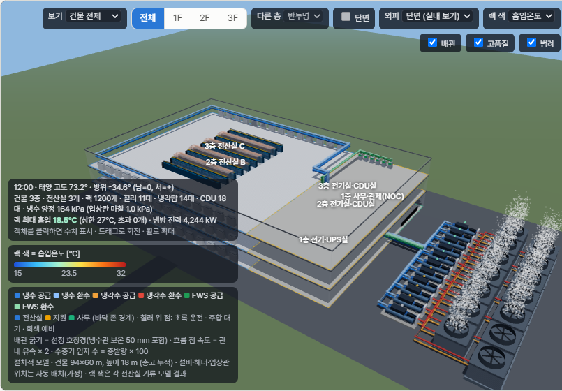
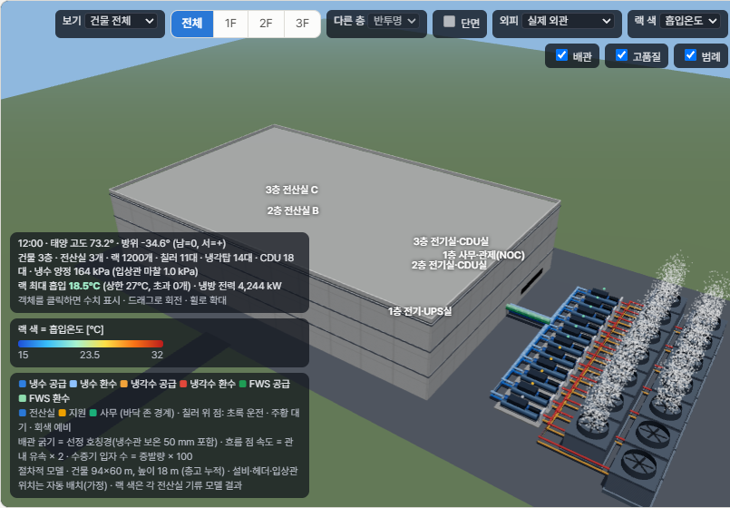
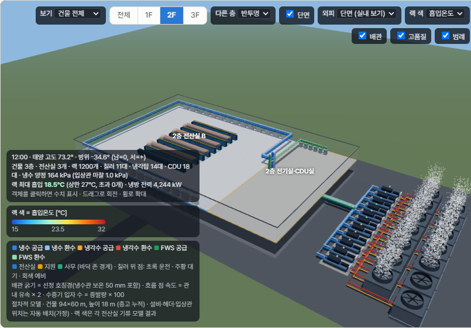
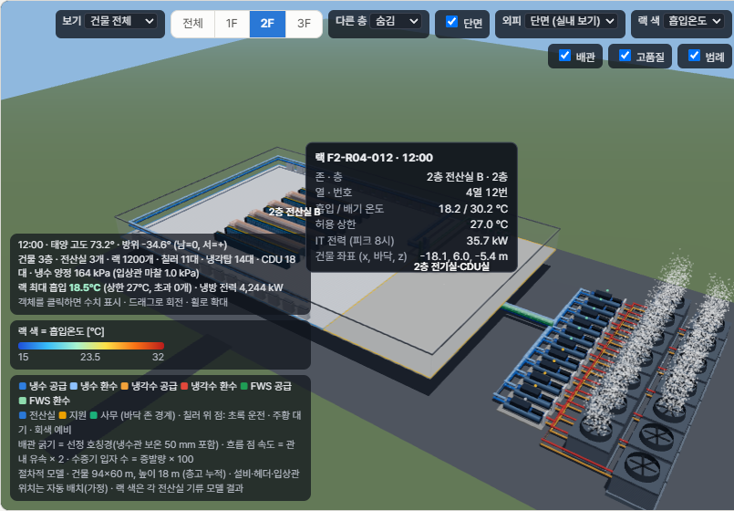
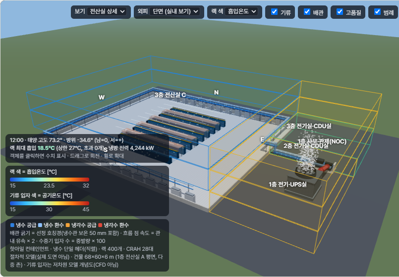
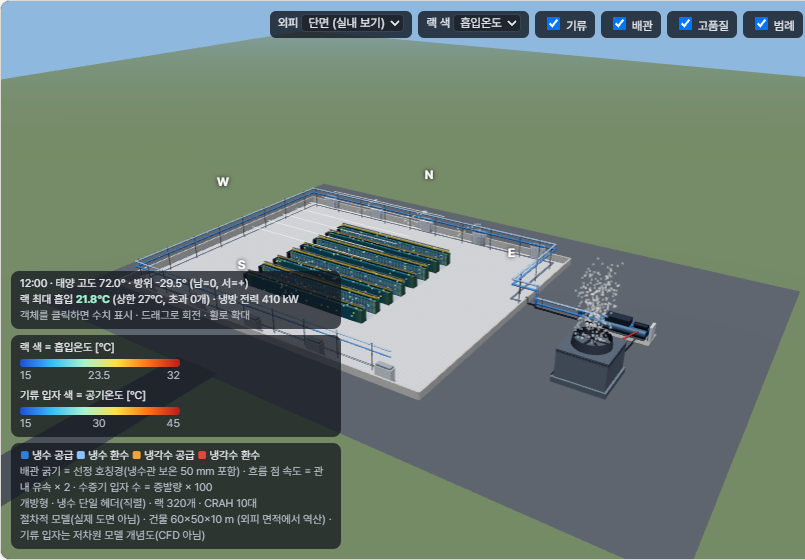

# Phase 18 — 다중 존(적층 건물) · 자동 튜닝

## 1. 다중 존

### 구조
- 시나리오에 `zones` 를 넣으면 다중 존. 없으면 기존 단일 존 그대로 (코드 경로도 같음: `engine.simulate` → `simulate_zone`)
- 존 = 단일 존 시나리오 하나 (`hvac/multizone.py: zone_scenario`). 엔진 수식은 바꾸지 않고 존별 결과를 더한다
  - 건물 공통: 사이트·기상·냉각 설비(`cooling_plant`)·IT 시간 모양(`it_load.utilization`)·운전점(`cooling_layout`)
  - 존별: 외기 접촉면(`envelope`), IT 설계부하, 실내 설정, 면적·조명·인원·외기량·기타 발열, 냉각 방식(선택), 랙 격자(전산실)
- 합산이 맞는 이유: 엔진의 설비 식은 존 부하에 선형이다 (칠러 COP·프리쿨링 비율·R1 제어 상태는 기상·수온에만 의존)
  - 테스트 1: 존 1개짜리 = 단일 존 결과 (시간별 일치)
  - 테스트 2: 서울 샘플을 동·서 두 존으로 나누면 합 = 단일 존 (반올림 차 0.2% 이내)

### 존 사이 전도열 (새로 넣은 식 — 엔진 밖)
- 존 i 로 들어오는 열 q = Σ U·A·(T_이웃 − T_i) [kW]. 존의 기타 발열(`misc_kw`)에 더해 엔진에 넘긴다
- 같은 실내온도끼리는 0이다. 주고받는 열이 같아서 건물 전체 합은 항상 0이고, 테스트로 확인했다
- 정상상태이며 축열은 무시한다(엔진과 같은 가정). 1층 바닥(지반)은 단열로 본다

### 연성 모델 (기류·배관) — 전산실 존마다 해석하고 합침
| 항목 | 다중 존 규칙 |
|---|---|
| 랙 최대 흡입온도 | 전산실 중 최대 (제약은 모든 전산실에 적용) |
| 초과 랙 수, CRAH 팬 전력 | 합 (비 전산 존 공조 팬은 엔진 비율 계수 값) |
| CRAH 환기온도 | 최저 (코일 환수 접근 제약이 가장 빡빡한 곳) |
| 냉수 배관 | 건물 좌표 배관망 (칠러 N대 → 야드 헤더 → 입상관 → 층 분기 → 전산실 분기, 1-3절). 펌프 양정 = 전산실 경로 중 최대 (입상관 마찰 포함), 설계 유량 = 합 |
| 냉각수 배관 | 건물 전체 유량, 첫 전산실 기준 단일 배관 (양정 계산 그대로. 야드 헤더 기준 값은 참고값으로만 표시) |
| 운전점 | 건물 공통 하나 (급기·냉수 온도·풍량 배율·컨테인먼트·CRAH 대수). 랙 격자만 존별 |

이 합산 결과를 `airflow.analyze`·`plant.networks` 가 돌려주므로, 다음 기능이 같은 코드로 다중 존을 처리한다.
- 하루·연간 최적화
- 내일·다음 달 브리핑
- 투자 검토
- 자동 튜닝

### 예시: 해남 AI DC 다중 존 (2층 적층) — `data/scenario_haenam_ai_mz.json`
| 존 | 층 | 종류 | IT | 설정 | 비고 (모두 가정값) |
|---|---|---|---|---|---|
| 1층 전산실 A | 1 | 전산실 | 20 MW (랙 200) | 24℃ | 서쪽 95 m |
| 1층 전기실 | 1 | 전기·기계실 | – | 30℃ | 장비 발열 200 kW |
| 2층 전산실 B | 2 | 전산실 | 20 MW (랙 200) | 24℃ | 지붕 |
| 2층 사무·관제 | 2 | 사무 | – | 24℃ | 조명 12 W/m2, 20명, 창 |

- 층간 슬래브 U는 2.0, 내벽 U는 1.5 W/m2K로 가정했다. 단일 존 해남 시나리오와 기상·IT·설비는 같다
- 설계일 결과: 일 냉방부하 874.9 MWh로 단일 존보다 5 MWh 많다. 차이는 대부분 전기실 장비 발열 가정값이다
- 일 PUE는 1.184 (단일 존 1.182)
- 존간 전도: 전기실 → 사무실 27.6 kW, 전기실 → 1층 전산실 3.5 kW

### 아직 단일 존만 되는 기능 (다중 존이면 422로 안내)
- 랙 편집, 증설 배치
- IT 데이터 적용(랙 매칭)
- BMS 보정
- (CAD 도면 적용은 아래 1-2 에서 다중 층 지원)

### 시간 (해남 다중 존, 이 PC)
| 계산 | 단일 존 | 다중 존 |
|---|---|---|
| 연간 3방식 | 1.4초 | 8.6초 |
| 하루 최적화 | – | 4.6초 |
| 연간 최적화 | – | 7.2초 |
| 다음 달 브리핑 | – | 0.6초 |
| 투자 검토 (1안) | – | 23초 |

## 1-2. CAD(DXF) 다중 층·다중 존 가져오기 (`hvac/cad_zones.py`)

### 규칙
- **층**: 레이어 이름 접두어 `F2-`, `2F-`, `L2-`, `2층` → 2층 (floor 1). 접두어 없는 레이어(`SITE-`, `ROOF-` 등)는 공통
  - 역할 있는 층이 둘 이상이면 다중 존으로 해석한다. 층이 하나면 기존 단일 존 경로 그대로 (결과 바이트 단위로 같음, 테스트)
- **존**: '존 경계' 역할(이름에 ZONE/ROOM/존) 레이어의 닫힌 폴리선
  - 경계 안 문자 `id | kind` (kind: data_hall/support/office)를 읽는다
  - 문자가 없으면 자동 id(`F2_Z1`)와 종류 추정: 랙이 있으면 전산실, 외벽에 창이 있으면 사무, 그 외 지원실
  - 한 존 안에 라벨이 둘 이상이면 경계가 빠진 것으로 보고 자동 id + 경고
  - 존 경계가 없는 층은 층 외곽선 = 존 하나. 층 외곽선이 없으면 공통 외곽선, 그것도 없으면 존들의 외접 사각형(경고)
- **블록 역할은 그 블록이 놓인 층에서만**: 키 `블록@F2`. 층 없이 `블록`만 주면 모든 층(각 층 안에서). 랙·CRAH·창도 같은 층 존에만 배정

### 계산
| 항목 | 규칙 |
|---|---|
| geometry | 경계의 외접 사각형 (3D 좌표계, 원점 = 건물 중심), 높이 = 층고 (층별 입력, 기본 6 m) |
| 외벽 | 존 경계 변 중 층 외곽선과 겹친 길이(1 m 안, 나란한 변) x 층고 → 방위별 (진북 각도, 단일 층과 같은 방위 규칙) − 창 |
| 창 | 가장 가까운 존 외기 변(3 m 안)에 배정: 도면상 폭 x 창 높이 (가정 1.5 m) |
| 지붕 | 바로 위층 존과 겹치지 않는 면적 (최상층 = 존 면적). 1층 바닥은 단열 |
| 내벽 (wall) | 같은 층 존끼리 맞닿은 변 길이 x 층고 |
| 슬래브 (slab) | 바로 위층 존과 평면이 겹친 면적 (볼록 다각형 클리핑, 둘 다 오목하면 외접 사각형 근사 + 경고) |
| 내부 경계 U | 같은 쌍이 기존 시나리오에 있으면 그 값, 없으면 슬래브 2.0·내벽 1.5 W/m²K (가정값) |
| IT | 전산실 존 안 랙 블록의 KW 속성 합. 속성 없는 랙 = 랙당 kW 입력값 (비우면 기존 IT/랙 수, 가정) |
| 랙·CRAH | 존 좌표계(원점 = 존 중심) items, 존별 `crah_positions` (새 필드) |
| 공통 | 운전점·설비 계수(cooling_layout)는 기존 값. 옥외 칠러·냉각탑은 단일 층과 같은 규칙 |

- 도면에 없는 값(실내 설정·조명·인원·외기량·기타 발열·냉각 방식)은 **같은 id 의 기존 존 값을 이어받는다**
- 새 존이면 인원·외기량은 건물 값의 면적 비례로, 기타 발열은 0으로 둔다 (가정값, 존별 근거에 표시)
- 보고서: 존마다 경계 출처, 종류 근거, 면적, 방위별 외벽 길이, 창·지붕, IT 출처, 이어받음/가정값

### 화면 (데이터 입력 → ① CAD 도면)
- 층 탭: 그 층 레이어와 공통 레이어만 표·미리보기에 표시. 블록 역할 표는 (블록, 층)마다
- 층별 층고, 랙당 kW 입력
- 결과: 층별 배치 미리보기(존 경계 점선), 존 표 — 이름·종류·IT 수정 → '수정 반영(다시 해석)' → '다중 존 시나리오로 적용'
- 적용하면 출처 `cad`(zones·envelope·building·it_load.design_kw·연면적), 되돌리기 가능
- 상단 시나리오 선택에 '3층 더미 DC (다중 존 7개·전산실 3개, CAD 도면 짝)' 추가

### 정답 대조 (`cad/datacenter_3f_dummy.dxf` ↔ `data/scenario_3f_dummy_mz.json`, tests/test_cad_zones.py)
| 항목 | 결과 |
|---|---|
| 존 7개 id·종류·층 (1~3층 전산실 A·B·C, 1층 사무·전기, 2·3층 전기·CDU실) | 일치 |
| 면적 4,080 / 1,560 / 624 / 936 m², 방위별 외벽·창, 지붕 | 일치 (오차 0) |
| partitions 슬래브 5쌍·내벽 5쌍 면적 | 일치 |
| 전산실별 랙 400개·IT 16,000 kW, CRAH 28대 | 일치. 랙 좌표 = 정답 격자 좌표 |
| /simulate 일 냉방부하·PUE (정답 시나리오 위에 적용) | ±1% 안 (테스트) |
| F2 블록만 랙 지정 | 랙 400개 (F1·F3 랙 0) |
| CDU 역할 (`F*-M-CDU`) · 칠러 11·냉각탑 14 폴리선 | CDU 층별 6대, 위치 = 건물 전체 보기 기본 배치와 0.01 m 안 |
| 단일 층 도면 (datacenter_dummy.dxf, 샘플 도면, F1- 접두어 하나) | 기존과 같음 |

- 단일 존 해남 시나리오 위에 적용하면 냉방부하가 −1.6%다
  - 도면에는 전기실 장비 발열이 없어서다. 정답의 250·150·150 kW 는 가정값이고, 존 표 아래 근거에 '기타 발열 0 — 입력 필요'로 나온다

- 정답 쌍은 `cad/gen_3f.py` 가 같은 치수 정의에서 만든다 (7존 판). 시나리오는 기존 파일과 바이트 단위로 같고,
  도면의 칠러·냉각탑·CDU 위치는 `hvac.building_view.plant_layout` (아래 1-3절) 규칙을 그대로 쓴다

## 1-3. 건물 전체 3D (`hvac/building_view.py`, `/cooling/evaluate` 의 `building_view`)

다중 존이면 evaluate 응답에 `building_view` 가 붙는다. 기존 필드(airflow·piping·geometry = 선택 전산실 존 좌표)는 그대로,
단일 존 응답에는 없다 (회귀 스냅샷 불변).

### 좌표·데이터
- 건물 좌표: 원점 = 건물 중심(존 x_m/z_m 기준), x=동, y=위, z=남. 층 바닥 높이 = 층고 누적 (그 층 존 높이 중 최대)
- `floors` [{floor, elevation_m, height_m}], `footprint` (CAD 외곽선, 없으면 존 외접 사각형), `zones` (위치·크기·바닥 높이)
- `halls`: 전산실마다 랙 {x,y,z,row,col,id,kw,inlet_c}, 24시간 흡입온도, CRAH {x,y,z,airflow} — 존 좌표 + 존 위치 + 층 높이
  - 격자 랙 id = `F{층}-R{열:02}-{번:03}` (도면 생성기 RACK_ID 와 같은 규칙), CAD 랙은 도면 id
- `plant`: 칠러·냉각탑 N대 {pos, size, standby}, CDU {floor, zone, pos, size}, 위치 출처(cad/auto)
- `piping`: 구간마다 PipeSegment 형식(dn·유량·길이) + `part`(칠러 연결·야드 헤더·건물 인입·입상관·층 분기·전산실 분기·냉각탑 연결·
  냉각수 헤더·FWS 인입/입상관/층 분기·CDU 연결)·zone·floor, 인입점, 입상관 위치·높이

### 배치 규칙 (가정값 — 도면 위치가 있으면 도면 우선)
| 설비 | 규칙 |
|---|---|
| 칠러 | 건물 외곽 동측 벽 + gap_east_m 에 한 열, 간격 = 깊이 + 1.5 m, 대수 = plant_units total (없으면 1대, chiller_z_m) |
| 냉각탑 | 칠러 열 동측 6 m 뒤 열, 간격 = 깊이 + 1 m. 열 길이가 건물·칠러 열보다 길면 다음 열 (반 칸 엇갈림, 배관이 탑 사이로) |
| CDU | 대수를 전산실 IT 비율로 나눠 같은 층 지원(support) 존(가장 넓은 곳)에 2.2 x 3 m 격자 (한 줄 6대) |
| 예비기 | 헤더 접속점에서 먼 순서로 k대 (배관 운전 유량 0, 관경은 1대 유량) |
| 입상관 | 전산실 동측 벽(인입점) 최대 x + 2 m, z = 가장 낮은 전산실 인입점. FWS 입상관은 z + 2 m |

- CAD: `cdu` 역할(레이어 키워드 CDU) — 층별 CDU 블록 중심 → `cooling_layout.plant.cdu_positions` [{floor, x_m, z_m}].
  다중 층 도면에서 칠러·냉각탑 닫힌 폴리선이 2개 이상이면 각 중심 → `chiller_positions` / `tower_positions` (새 필드, 건물 좌표)

### 배관·펌프 양정 (다중 존)
- 냉수: 칠러 → 야드 헤더 → 건물 인입 → 입상관(층 분기 높이마다 끊음) → 층 분기 → 전산실 인입점(실 동측 벽) → 기존 전산실 분기.
  기존 전산실 분기(`chw_network`)는 존 좌표 트렁크를 인입점에서 끊고 실 안쪽만 옮긴다
- **양정 = 2 x (야드 + 건물 인입 + 입상관 + 층 분기 + 전산실 분기 최원단 마찰) + 증발기 + 코일, 전산실 중 최대.**
  입상관 정수두는 폐회로라 0, 마찰은 입상관 길이 포함 (기존 합산 규칙 그대로)
- 냉각수: 냉각탑 → 냉각수 헤더 → 칠러 응축기 구간을 표시. 양정 계산은 **기존 단일 배관 그대로** (야드 헤더 기준 값은 `cw_yard_dynamic_kpa` 참고값)
- FWS (hybrid_dlc / immersion): 야드 → FWS 입상관 → 층별 CDU (가까운 순 직렬 분기). 표시용 — 액체 루프 펌프 전력은 엔진 계수 그대로

| 바뀐 결과 (다중 존만, 단일 존·회귀 스냅샷·plant_vec 패리티 불변) | 이전 | 지금 |
|---|---|---|
| 3층 더미: 냉수 양정 / 최원단 경로 | 159.1 kPa / 217 m | 163.5 kPa / 279 m (입상관 마찰 1.0 kPa) |
| 3층 더미: 하루 냉수 펌프 전력량 · 냉방 전력 합계 | 263.6 · 102,789 kWh | 270.9 (+2.8%) · +7.3 kWh (+0.007%) |
| 해남 다중 존: 냉수 양정 | 161.7 kPa | 166.4 kPa (냉수 펌프 +2.9%) |

기존 테스트 중 바뀐 기대값은 없음 (다중 존 양정을 고정값으로 확인하는 테스트가 없었음). 새 테스트: `tests/test_building_view.py`.
- 냉각수까지 야드 헤더 기준으로 바꾸면 3층 더미 냉각수 펌프 +10% (양정 60.3 → 73.1 kPa), 냉방 전력 +0.77% — 승인 전이라 반영하지 않음

### 화면 (운전 현황 3D)
- 보기: **건물 전체** (다중 존 기본) / **전산실 상세** (기존 화면, 기류 입자·존 고스트 포함)
- 건물 전체: 층 슬래브, 전체 높이 외벽(층 구분선), 존별 창, 지붕·파라펫(실제 외관), 바닥 존 경계(색 = 종류), 층마다 전산실 랙(인스턴싱,
  흡입온도 색)·CRAH·컨테인먼트, 지원 존 CDU, 건물 좌표 배관(입상관 포함, 굵기 = 호칭경, 흐름 점 속도 = 유속), 야드 칠러·냉각탑 N대
  (운전 표시 점: 초록 운전 · 주황 대기 · 회색 예비, 운전 냉각탑만 팬 회전·수증기)
- 층 선택: 전체 / 1F / 2F / 3F — 다른 층 반투명 또는 숨김, 단면(선택 층 위 숨김, 입상관은 잘라 표시)
- 랙·CRAH·칠러·냉각탑·CDU·배관 클릭 → 상세 패널 (존·층, 운전 대수, 배관 구간 이름 표시)
- 성능: 랙은 전산실마다 인스턴싱 2개, 배관 전체는 원통 인스턴싱 1개 + 흐름 점 인스턴싱 1개 (배관 420여 구간을 그리기 2회로)

| 화면 | 파일 |
|---|---|
| 건물 전체 (단면 외피) |  |
| 실제 외관 |  |
| 2F 선택 + 단면 (위층 숨김, 아래층 반투명) |  |
| 2F 만 (다른 층 숨김) + 랙 클릭 상세 |  |
| 전산실 상세 (기존 화면) |  |
| 단일 존 서울 샘플 (보기 선택 없음, 기존과 같음) |  |

### 한계
- 존·외곽은 사각형(외접 사각형) 기준. 칠러·냉각탑·CDU·헤더·입상관 경로는 표시·배관 길이용 가정 배치
- 전산실 상세 화면은 기존 존 좌표계 그대로 (칠러가 전산실 동측 gap 에 그려짐) — 실제 배치는 건물 전체 보기에서 확인
- 60 fps 확인: 이 PC 헤드리스 브라우저는 소프트웨어 렌더링(6 fps)이라 측정값이 의미 없음 — GPU 브라우저에서 확인 필요

## 2. 자동 튜닝 (`hvac/autotune.py`, 화면 '최적화 → 자동 튜닝')

### 사용자 설정 (브라우저에 저장)
- **파라미터와 우선순위**(위가 먼저), 켜기/끄기, 허용 범위·간격
  - 기본 순서: 타일 밸런싱 → CRAH 풍량 배율 → 급기온도 → 냉수 공급온도 → 냉수 ΔT → 컨테인먼트(공사) → CRAH 대수(공사)
  - 공사 항목은 기본으로 꺼져 있다
- **'영향도 순으로 정렬'**: 파라미터마다 한 단계씩 바꿔 계산한다. 그 결과 지금 있는 문제(흡입 여유 / 코일 공급 / 코일 환수)를 가장 잘 풀고 전력은 덜 느는 순서로 정렬한다
- **목표 흡입 여유**: 기본 1K이며, 브리핑의 '여유 작음' 주의 기준과 같다
- **해가 여러 개일 때 고르는 기준**: '가장 적게 바꾸기' 또는 '냉방 전력 최소'
- **'운전 현황에서 자동 계산'**: 켜면 주의·경고가 생길 때 바로 튜닝안을 계산한다. 적용은 항상 사용자가 직접 누른다

### 방법 — 우선순위 단계 탐색
1. 1순위 파라미터만으로 해를 찾는다. 없으면 2순위까지, 그다음 3순위까지 하나씩 넓힌다. 해가 처음 나온 단계에서 멈춘다
   → 뒤 순위 파라미터는 앞 순위만으로 해결이 안 될 때만 바뀐다
2. 기류 파라미터(타일·풍량·컨테인먼트·CRAH 대수)는 모든 조합을 기류 모델로 해석한다
3. 온도는 역산한다. 흡입 상승폭은 급기온도와 무관하므로 다음 상한이 정해진다
   - 급기 ≤ 상한 − 목표 여유 − 상승폭
   - 냉수 공급 ≤ 급기 − 코일 접근
   - 냉수 환수 ≤ CRAH 환기 − 코일 환수 접근
4. 해 고르기
   - 가장 적게 바꾸기: 변경량 점수 Σ(|변화|/범위 폭)×(1+순위)가 가장 작은 해. 뒤 순위를 바꿀수록 비싸다
   - 냉방 전력 최소: 경고가 없는 해 중 연성 모델 일 냉방 전력량이 가장 작은 해
5. 결과는 다시 계산해서(`advice.evaluate_issues`) 남는 주의·경고를 보여 준다. '이 설정 적용'을 누르면 출처가 '최적화(자동 튜닝)'로 기록되고, 되돌리기가 된다

### 확인한 경우 (서울 샘플)
| 상황 | 가장 적게 바꾸기 | 냉방 전력 최소 |
|---|---|---|
| 급기 24℃ (초과 랙 16개) | 급기 24 → 22℃ (3단계) | 타일 0.4, 풍량 0.6, 급기 18℃ (−15% kWh) |
| 냉수 공급 16℃ (코일 충돌) | 냉수 공급 16 → 12℃ (4단계) | 타일 0.4, 풍량 0.75, 급기 22℃ (−12%) |
| 냉수 환수 26℃ (코일 충돌) | 풍량 1.0 → 0.85 (2단계) | 타일 0.4, 풍량 0.6 |
| 풍량 0.6 (여유 0.8K) | 타일 0.3 → 0.4 (1단계) | 같음 |

- 모든 경우 적용한 뒤 주의·경고가 0이었다
- 해남 다중 존에서도 같은 동작을 확인했고, 실행 1회는 3초 이내였다

### 한계
- 제약은 운전 현황 날짜(설계일)의 피크 시각만 본다. 다음 날·다음 달 기상에서 여유가 충분한지는 브리핑이 확인한다
- 공사 항목의 공사비는 목적함수에 없다. 공사비는 투자 검토에서 반영한다
