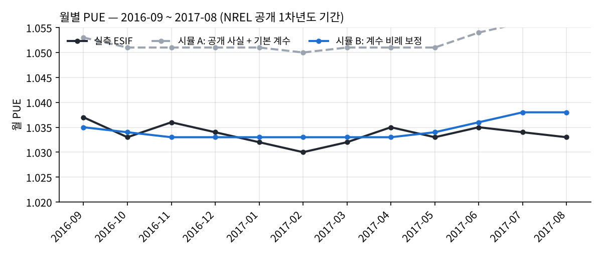
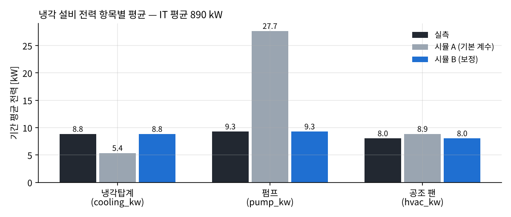
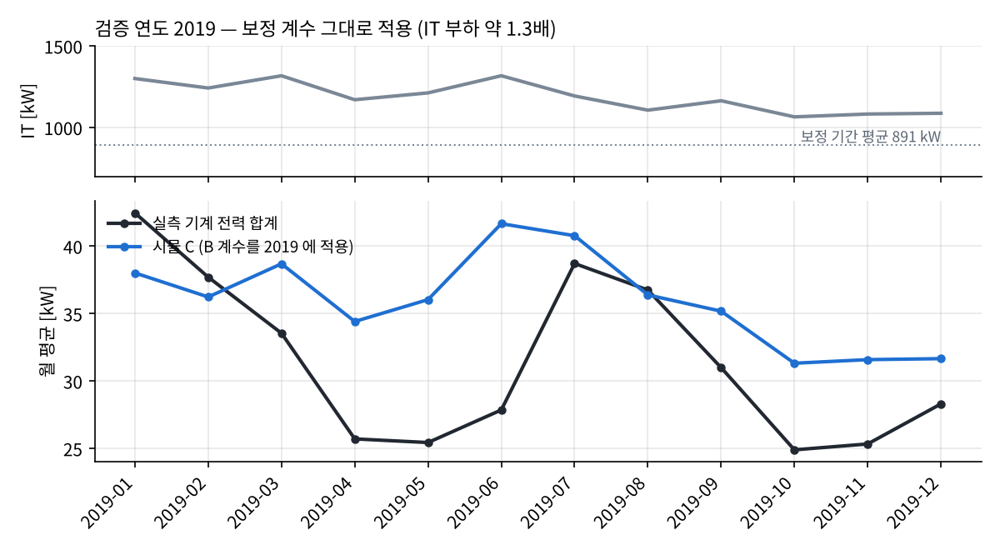
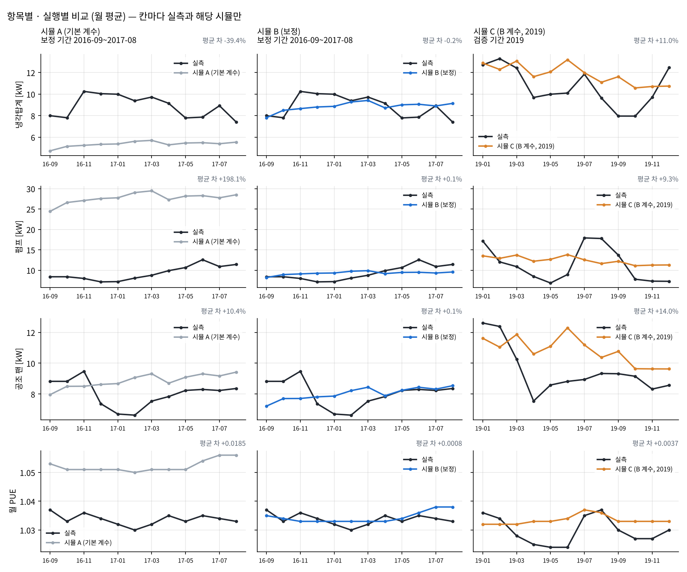
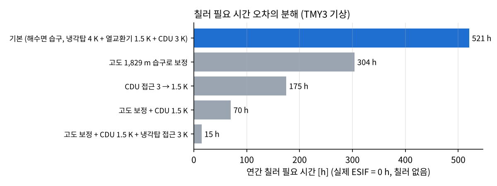

# 실측 비교 — NREL ESIF HPC 데이터센터

시뮬레이터를 실제 운영 중인 데이터센터의 실측과 비교한 결과입니다. 엔진 수식은 바꾸지 않았고, 시나리오만 ESIF 조건에 맞췄습니다.

## 1. 비교 대상과 데이터

| 항목 | 내용 |
|---|---|
| 시설 | NREL ESIF HPC 데이터센터 (미국 콜로라도 Golden, 해발 약 1,829 m), 전산실 10,000 ft² |
| 냉각 방식 | 랙 직접 액체냉각(랙 발열 95% 이상 액체 회수), **칠러 없음**, 공급 24 ℃ / 환수 35~40 ℃, 냉각탑 + 열사이펀 건식냉각기 + 건물 난방 재활용 |
| 실측 | `data_esif/esif_hourly_mst.csv` (NREL 원본 1~5분 값 → 시간 평균). IT, 냉각탑계, 펌프, 공조 팬, 조명·콘센트 전력, PUE |
| 보정 기간 | 2016-09-01 ~ 2017-08-31 (8,682 h). NREL이 공개한 1차년도와 같은 기간 |
| 검증 기간 | 2019-01-01 ~ 2019-12-31 (8,633 h). IT 평균 1,187 kW로 보정 기간(891 kW)보다 약 1.3배 |
| 기상 | **Golden, CO TMY3 표준기상년** (EnergyPlus 저장소). 그해 실제 기상이 아님 → 아래 5절 참고 |

정리한 데이터가 맞는지 확인했습니다. 보정 기간 실측 PUE는 1.0336, IT 평균은 890.5 kW로, NREL 공개값(PUE 1.034, 시간 평균 IT 888 kW)과 일치합니다. 실측 PUE는 (IT + 냉각탑계 + 펌프 + 공조 팬 + 조명·콘센트) / IT와 같습니다(시간별 차이 중앙값 0.000005).

### 비교 항목 대응

| 실측 (NREL 정의) | 시뮬레이터 |
|---|---|
| cooling_kw: 냉각탑·건식냉각기 팬, 동결방지 열선, 필터 펌프(2.67 kW 고정) | tower_fan |
| pump_kw: 에너지회수수(ERW)·냉각탑수 루프 펌프, 팬월 부스터 펌프 | chw_pump + cw_pump + liquid_pump |
| hvac_kw: 팬월, 전기실 팬코일, 외기 공급기 | crah_fan |
| PUE = (IT + 위 3개 + 조명·콘센트) / IT | 같은 정의 (UPS 손실 0) |
| 칠러 0대 | 칠러 필요 시간 |

## 2. 시뮬레이션 조건

| 구분 | 설정 | 근거 |
|---|---|---|
| 사실 | hybrid_dlc, 액체 회수 0.794 | NREL: 2016 가동 IT 0.91 MW = 액체냉각 HPC 0.76 + 공랭 0.15 MW, 액체 랙은 발열 95% 이상 회수 → 0.76 × 0.95 ÷ 0.91 |
| 사실 | TCS 공급 24 ℃ / 환수 35 ℃ | NREL: 공급 24 ℃(75 ℉), 환수 35~40 ℃ |
| 사실 | UPS 손실 0 | NREL PUE 집계 항목에 전기 손실 없음 → 정의를 맞춤 |
| 사실 | 바닥 929 m², 조명 4 W/m² | 10,000 ft². 조명은 실측 평균 3.7 kW를 입력값으로 사용 (비교 대상 아님) |
| 사실 | IT 시간값 = 실측 it_power_kw | |
| 가정 | 외피 최소(벽 각 50 m², 지붕·창 0) | 건물 안 전산실 |
| 가정 | 외기 1,000 m³/h | 외기 공급기 풍량 미공개 |
| 가정 | 공기측 코일 21/27 ℃ | 팬월 코일도 칠러 없는 냉각탑수 계통에서 공급된다고 가정 |
| 가정 | 펌프·팬 계수, 접근온도(냉각탑 4 K, 열교환기 1.5 K, CDU 3 K), 농축배수 COC 4 | 프로젝트 기본값 그대로 |

실행은 세 가지입니다.
- **A:** 공개 사실과 프로젝트 기본 계수
- **B:** A에서 계수만 비례 보정해 보정 기간 평균을 실측에 맞춤. 구조는 그대로
- **C:** B의 계수를 2019년에 그대로 적용한 검증

## 3. 결과




| 항목 | 실측 | A 기본 계수 | B 보정 | C 2019 검증 (실측 / 시뮬) |
|---|---|---|---|---|
| PUE (기간) | **1.0336** | 1.0521 (+0.0185) | 1.0344 (+0.0008) | 1.0297 / 1.0334 (+0.0038) |
| 냉각탑계 평균 kW | 8.85 | 5.36 (0.61배) | 8.84 | 10.62 / 11.80 |
| 펌프 평균 kW | 9.29 | 27.66 (**2.98배**) | 9.29 | 11.35 / 12.39 |
| 공조 팬 평균 kW | 8.04 | 8.86 (1.10배) | 8.04 | 9.45 / 10.80 |
| 기계 전력 합계 kW | 26.18 | 42.69 (1.63배) | 26.96 | 31.42 / 35.99 (**+14.5%**) |
| 칠러 운전 시간 | **0 h** | 521 h | 521 h | 519 h |
| 시간별 상관 (기계 합계) | | 0.26 | 0.26 | 0.29 |

> **수정 이력 (2026-11-05):** 처음에는 액체 회수율을 0.95로 넣었습니다. 이는 액체 랙 기준값을 IT 전체에 적용한 오류입니다. 그 결과 공조 팬이 0.24배로 크게 과소했고, PUE 오차도 +0.0111로 작게 보였습니다. 공랭 장비 0.15 MW를 반영해 0.794로 고쳤고, 이전 결과는 `out_v1_lf095/`에 남겨 두었습니다.

ASHRAE Guideline 14 기준(시간값 CV(RMSE) ≤ 30%, |NMBE| ≤ 10%)으로 본 기계 전력 합계는 다음과 같습니다.
- **B:** NMBE −3.0%, CV 23.2%. 기준 안이지만 같은 기간에 맞춘 결과입니다.
- **C:** 2019년 NMBE −14.5%, CV 37.9%. **다른 해에서는 기준을 벗어납니다.**

**요약:** 공개 사실과 기본 계수로 PUE 오차는 +0.0185입니다. 항목별로는 공조 팬이 1.10배로 가깝지만, 펌프는 2.98배, 냉각탑계는 0.61배로 틀립니다. 계수 보정으로 평균은 맞출 수 있어도, 부하가 바뀐 다른 해에는 맞지 않습니다.



항목 × 실행별로 나눈 비교입니다. 칸마다 실측과 해당 시뮬 두 선만 그리고, 범례도 칸마다 따로 둡니다.



### 시뮬 A → B 보정 단계

무엇을 바꾸고 두는지, 항목별 비율, 계수 조정, 재실행 확인, PUE 기여 분해, 다른 해에서의 한계를 [out/calibration_steps.md](out/calibration_steps.md)에 단계별로 정리했습니다.

## 4. 오차 원인 (근거와 함께)

1. **보조동력이 '부하 비례'로만 계산됨: 구조 문제, 가장 큼.**
   - 보정 기간(B) 기준, 실측 기계 전력과 IT의 시간 상관은 0.24인데 시뮬은 0.54입니다. 펌프만 보면 실측 0.14, 시뮬 1.00입니다.
   - 고정분 + IT 비례 + 기상 항으로 회귀하면 보정 기간 평균의 약 51%가 고정분입니다. 공조 팬은 79%, 냉각탑계는 47%, 펌프는 32%입니다.
   - 같은 회귀를 2019년에 적용하면 기계 합계 NMBE가 −14.5%에서 +4.1%로 줄어듭니다(`out/structure.json`).
   - 즉 실제 설비는 IT가 1.3배가 되어도 전력이 그만큼 늘지 않습니다(+20%).
2. **펌프 계수 과대(2.98배), 냉각탑계 과소(0.61배): 계수 문제.**
   - 기본 계수는 대형 AI 센터 가정값(액체 루프 펌프 0.02 kW/kW 등)입니다.
   - 보정값은 액체 펌프 0.0067, 냉각수 펌프 0.0040, 냉수 펌프 0.0050 kW/kW, 냉각탑 팬 0.0099 kW/kW입니다. 팬 발열비는 0.045로 기본값 0.05에 가깝습니다.
   - 냉각탑계 실측에는 동결방지 열선과 필터 펌프(2.67 kW 고정)가 들어 있습니다. 엔진의 냉각탑 팬에는 이런 항목이 없습니다.
   - 공조 팬은 평균은 맞지만, 실측은 IT와 거의 무관합니다(상관 0.08, 시뮬 0.95). 팬월·외기 공급기·전기실 팬코일의 상시 운전분으로 보이며, 이 부분은 **가설**입니다.
3. **칠러 필요 시간 521 h (실제 0 h).**
   - 엔진 습구식(Stull)은 해수면 기준이라, 해발 1,829 m(약 81.2 kPa)에서는 습구를 평균 0.96 K 높게 계산합니다(건구 20 ℃ 이상).
   - 고도를 보정하면 304 h로 줄고, CDU 접근을 3 K에서 1.5 K로 낮추면 70 h, 냉각탑 접근까지 3 K로 낮추면 15 h가 됩니다.
   - 실제 설비는 칠러가 없어 최고 습구일에 공급온도가 24 ℃까지 올라가도록 설계됐습니다. 반면 엔진은 공급온도를 넘으면 칠러를 켭니다.
   - 이 칠러 전력 때문에 6~8월 시뮬 PUE가 올라갑니다(그래프 1).

   

4. **계절 변화가 반대: 구조 문제와 가설.**
   - 실측 냉각탑계 전력은 겨울에 더 큽니다(습구와 상관 −0.19). 동결방지 열선이 포함된 항목이라 그런 것으로 보입니다.
   - 실측 펌프는 여름에 더 큽니다(습구와 상관 +0.47). 엔진의 펌프·냉각탑 팬은 기상과 무관합니다(상관 −0.01~−0.03).
5. **WUE 1.98 L/kWh.**
   - NREL 공개값은 1차년도 실제 0.7입니다. 냉각탑만 썼을 때의 추정은 자료에 따라 1.42(fy19osti 74464)와 1.27(OSTI 1471661)로 다릅니다.
   - 시뮬은 모든 열을 냉각탑으로 버리고 COC 4 블로다운을 더합니다. 증발만으로 약 1.48 L/kWh이고, 블로다운이 약 0.49입니다.
   - 실제로는 열의 42%를 열사이펀(건식), 11%를 건물 난방으로 처리합니다. 엔진에는 이 경로가 없습니다.

## 5. 한계

- **기상:** TMY3 표준기상년을 써서 그해 실제 날씨와 다릅니다. 시간별 상관과 계절 분석은 약하게 나옵니다. 현장 외기 파일(NREL 같은 페이지의 *ESIF DC Outside Weather Station Timeseries Data*)을 `data_esif/`에 넣고 `python validation_esif/aggregate_outside.py`를 실행한 뒤 다시 돌리면, 온·습도는 현장값으로 바뀝니다(일사는 TMY3).
- **설비 정보:** 장비 대수, 제어 방식, 팬월 풍량은 공개 자료에서 찾지 못했습니다. 4절의 '보이는 것으로'는 확인되지 않은 추정입니다.
- **보정:** 보정은 평균 비례 조정 한 가지이고, 민감도 분석 전체는 아닙니다.

## 6. 실행

```
pip install pandas matplotlib            # 필요하면
python validation_esif/esif_compare.py   # A·B·C 실행 → out/summary.json, monthly_*.csv, hourly_*.csv
python validation_esif/sensitivity.py    # 칠러 시간 원인 분해
python validation_esif/structure.py      # 고정분 + 비례 구조 검증
python validation_esif/calib_steps.py    # A → B 보정 단계 설명 → out/calibration_steps.md
python validation_esif/plots.py          # 그래프 (fig5 = 항목 × 실행 소분할)
python validation_esif/ai_diagnose.py    # OpenAI 오차 원인 진단 (backend/.env 의 키 사용) → out/ai_diagnosis.md
```

`ai_diagnose.py`는 계산을 하지 않습니다. 위 결과 파일만 근거 묶음으로 보내고, 원인 후보를 '근거 있음 / 가설'로 나눠 받습니다. 응답에 근거 묶음에 없는 숫자가 있으면 표시합니다(프로젝트 AI 해설과 같은 검사).

## 7. 엔진 개선 후보 (수식 변경이라 승인 필요)

1. 보조동력을 '고정분 + 부하 비례'로 계산 (펌프·팬·냉각탑 팬)
2. 습구온도에 사이트 대기압(고도) 반영
3. 칠러 없는 설비 옵션: 칠러 대신 공급온도 상승 허용, 초과 시간 표시
4. 냉각탑 외 방열 경로(건식냉각기, 열 재활용) 비율 → WUE

## 출처

- NREL HPC Facility PUE Data (data.gov / data.nlr.gov submission 300), CC BY 4.0
- NREL, Measuring Efficiency: PUE (항목 정의)
- NREL/TP fy19osti 74464 (설계·1차년도 성능: PUE 1.034, WUE 0.7, 방열 비율, 24 ℃ 공급)
- NREL fy17osti 68659 (열사이펀 하이브리드)
- EnergyPlus weather: USA_CO_Golden-NREL.724666_TMY3.epw
